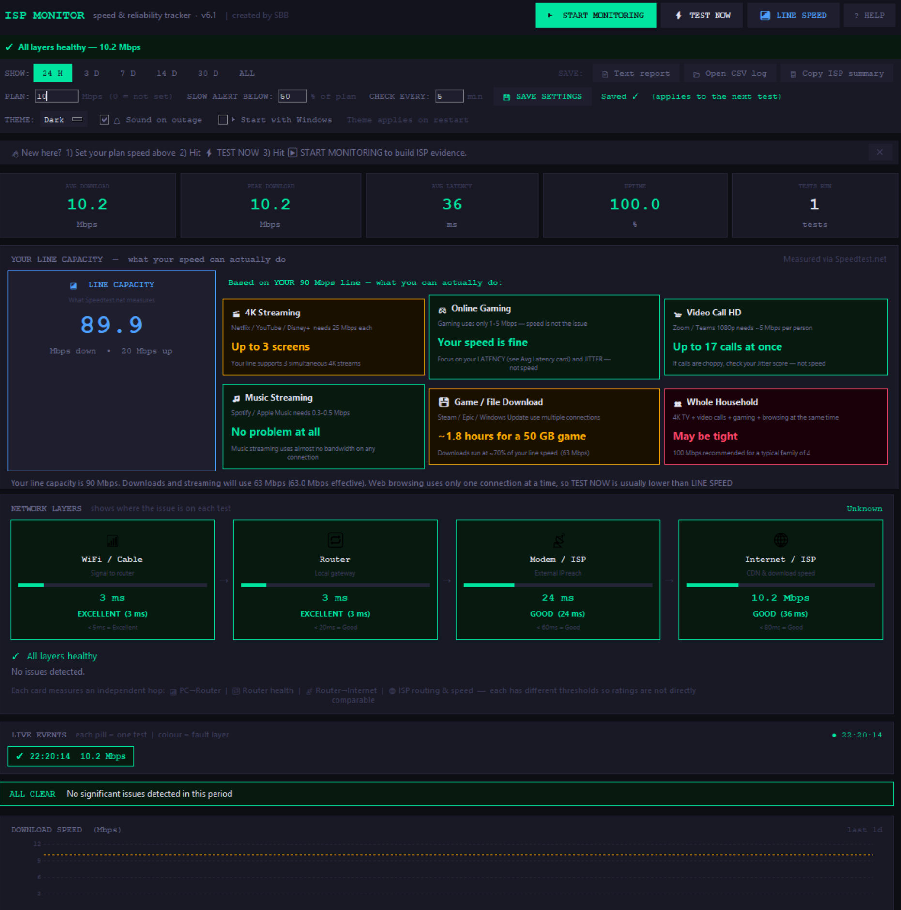

# ISP Monitor

Is your internet actually broken, or is it just slow? ISP Monitor answers
that — and builds the evidence you need when you call your provider.

It does two jobs:

1. **Test and pinpoint.** One click runs a layered test (your PC → router →
   modem → ISP → internet) and names the failing layer in plain English,
   with a fix to try. It also measures packet loss, WiFi signal strength,
   and DNS health, so "the internet is down" stops being a mystery.
2. **Monitor and prove.** Leave it running and it tests every few minutes,
   logs everything to a CSV, and turns the history into an ISP-ready report:
   uptime, downtime totals, outage windows, slowest hours, and which layer
   was at fault most often. That is the paper trail for a discount claim.



## What it measures

| Test | What it tells you |
| --- | --- |
| Download speed | Real files from public CDN servers, up to 8 seconds — real throughput, not connection setup |
| Router ping | PC → router latency (WiFi or cable quality) |
| Modem ping | Router → internet by raw IP, bypassing DNS |
| CDN latency | ISP routing quality to the wider internet |
| Packet loss | 10 probes per test; 20%+ flags LOSS |
| WiFi signal | Signal % on WiFi; below 40% names weak signal as the fault |
| DNS | Separates "DNS is broken" from "internet is broken" |
| Line speed | Your line's raw maximum up/down via Speedtest.net infrastructure |

## Quick start

**Option A — run the app (no build):**

```bat
pip install speedtest-cli
python isp_monitor.py
```

The core tests run with plain Python 3 (Windows, macOS, or Linux).
`speedtest-cli` is only needed for the LINE SPEED button.

**Option B — build a single .exe (Windows):**

Double-click `BUILD_EXE_MONITOR.bat`. It installs PyInstaller and
speedtest-cli, then builds `dist\ISP_Monitor.exe` — one file, no console
window, no install. Your log files save next to the .exe.

## Using it

- **⚡ TEST NOW** — full layered test right now, including a route trace
  when something flags.
- **▶ START MONITORING** — tests automatically every few minutes
  (adjustable). A sound and taskbar flash mark the start of an outage, so
  you don't have to watch it.
- **📶 LINE SPEED** — your line's maximum capacity, up and down, logged
  separately so you can compare "what I pay for" against "what I actually
  get."
- **Settings row** — your plan speed (SLOW flags below your chosen % of
  plan), slow-alert %, check interval, light/dark theme, outage sound,
  and start-with-Windows.
- **📄 Text report** — a plain-English report for your ISP.
- **📋 Copy ISP summary** — a short version on the clipboard, ready to
  paste into ISP chat.
- **📂 Open CSV log** — every test in a spreadsheet-friendly file.

## Files it creates (next to the app)

| File | Contents |
| --- | --- |
| `isp_log.csv` | Every routine test: speed, latency, jitter, packet loss, signal, DNS, layer, flags |
| `peak_log.csv` | Every LINE SPEED result (down + up) |
| `trace_log.txt` | Route traces from flagged tests |
| `isp_config.json` | Your settings (plan, thresholds, theme, window size) |

Old log files keep working: newer versions migrate the header
automatically, and your history is never wiped.

## Thresholds

| Flag | Meaning |
| --- | --- |
| OUTAGE | Download below 0.5 Mbps, or no response at all |
| SLOW | Below 10 Mbps, or below your chosen % of your plan |
| LAG | Latency above 150 ms |
| JITTER | Jitter above 40 ms |
| LOSS | Packet loss of 20% or more |
| DNS | Names won't resolve but IP connectivity works |

## Privacy

No accounts, no sign-in, no tracking. Nothing about you leaves your
machine except the test traffic itself: CDN downloads, pings, a DNS
lookup, and Speedtest servers when you press LINE SPEED.

## License

MIT — see `LICENSE`. Copyright 2026 SBB.

## Requirements

- Python 3.8+ (for running from source), or just Windows (for the .exe)
- `speedtest-cli` only for the LINE SPEED button
- Windows-only extras: WiFi signal %, start-with-Windows, taskbar flash.
  Everything else works on macOS and Linux too.

---

Created by SBB.
